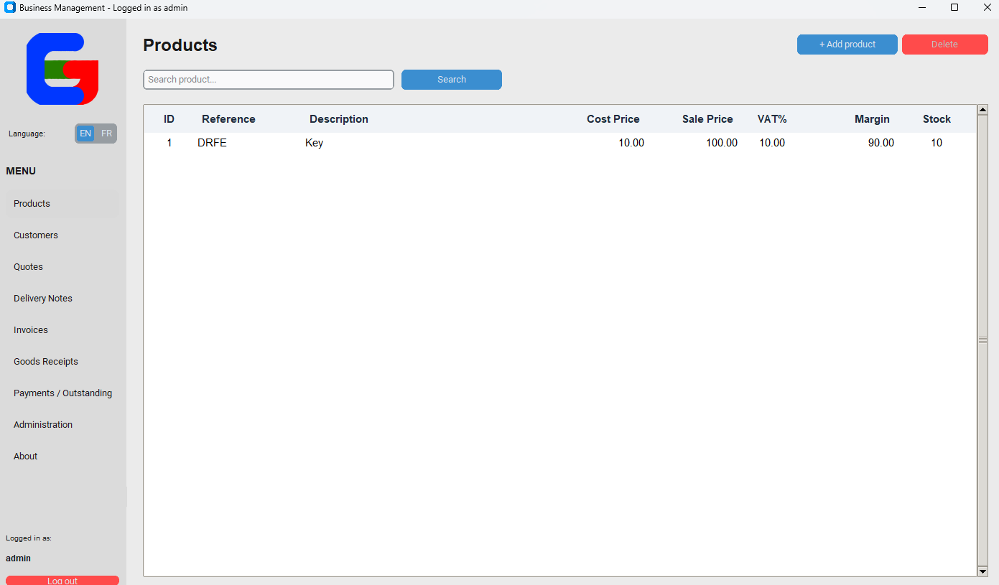

<p align="center">
  
</p>

<h1 align="center">Gestion Commercial Simple (GCS)</h1>

<p align="center">
  A modern, lightweight commercial management app for small to medium businesses.<br/>
  <b>Clients, Articles, Documents & Payments</b> — all in one desktop app.
</p>

<p align="center">
  <a href="https://www.python.org/downloads/"></a>
  <a href="https://github.com/SedikDarragi"></a>
  
  
  
</p>

<p align="center">
  <a href="#-quick-start">Quick Start</a> •
  <a href="#-features">Features</a> •
  <a href="#-project-structure">Structure</a> •
  <a href="#-security">Security</a> •
  <a href="SETUP.md">Setup Guide</a> •
  <a href="CONTRIBUTING.md">Contributing</a>
</p>

<p align="center">
  
</p>

---

## Table of Contents

- [About](#about)
- [Features](#-features)
- [Tech Stack](#-tech-stack)
- [Project Structure](#-project-structure)
- [Quick Start](#-quick-start)
- [Installation](#-installation)
- [Usage](#-usage)
- [Database](#-database)
- [Security](#-security)
- [Testing](#-testing)
- [Building an Executable](#-building-an-executable)
- [Troubleshooting](#-troubleshooting)
- [Roadmap](#-roadmap)
- [Contributing](#-contributing)
- [License](#-license)

---

## About

**GCS** is a desktop commercial management application built with **Python + customtkinter**. It was designed for shops, agencies and small teams that need to manage a product catalog, customer database, and commercial documents without the complexity of an ERP.

No cloud, no subscription — your data stays in a local `commercial.db` SQLite file next to the app.

> **Status:** `0.1.7 beta` — core features stable, single-user desktop only. See [CHANGELOG.md](CHANGELOG.md).

---

## Features

### Core Modules

| Module | What you can do |
|---|---|
| **Articles** | Create / edit / delete products, track `prix achat`, `prix vente`, `TVA`, `stock` and `marge` automatically |
| **Clients** | Customer database with `nom`, `email`, `telephone`, `adresse`, `matricule fiscale` |
| **Documents** | Create **Devis** (quotes), **BL** (delivery notes), **Factures** (invoices) and **Bon de réception** with numbering `DEV-2025-0001` |
| **Paiements** | Track payments per invoice, outstanding balances, and payment history |

### Document & Business Logic

*   Annual sequential numbering per document type (`sequences` table) — auto-resets each year
*   Numbers are previewed when a dialog opens and reserved atomically on save, so cancelling or failing never consumes a number
*   The sequence reconciles with the highest existing document number, and manual edits reject duplicate numbers
*   TVA / HT / TTC calculations, discount (`remise`) support per document
*   Document lifecycle: `brouillon` → `validé` → conversion (Devis → BL → Facture)
*   Stock awareness and payment mode / échéance handling
*   Export to **HTML** and **PDF** (`reportlab`), print-ready

### User Experience

*   **Click-to-sort** on every table with visual indicators `▲` / `▼`
*   **Zebra striping** + color-coded payment status (`Payé` in green, unpaid in red)
*   **Real-time search & autocomplete** for articles, clients and documents
*   **Real-time updates** — client balances refresh automatically after document/payment changes
*   Light mode with `clam` ttk theme, responsive dialogs, keyboard shortcuts

---

## Tech Stack

| Layer | Technology |
|---|---|
| **UI** | [customtkinter](https://github.com/TomSchimansky/CustomTkinter) `>=5.2.0`, `ttk.Treeview`, `Pillow` for images |
| **Data** | `SQLite` (stdlib `sqlite3`), single file `commercial.db` |
| **Export** | `reportlab` `>=4.0.0` for PDF, HTML export |
| **Security** | `hashlib.pbkdf2_hmac` + `secrets` |
| **Tests** | `pytest` (headless, no GUI required) |

> **Python required:** `>=3.11`

---

## Project Structure

```
GCS/
├── main.py              # Login / registration UI and DB bootstrap
├── accounts.py          # Account model, password hashing, auth, lockout, admin guards
├── main_app.py          # Main application — UI, business logic, exports (~8100 lines)
├── requirements.txt     # Runtime dependencies
├── assets/
│   └── logo.png         # App logo (7.5 KB)
├── tests/
│   ├── conftest.py      # headless customtkinter mock
│   ├── test_security.py # hash / verify / salt tests
│   ├── test_accounts.py # account model, lockout, roles, password policy
│   ├── test_database.py # schema, idempotency, sequences
│   └── test_db_path.py  # DB path resolution
├── commercial.db        # Created on first run (gitignored)
├── README.md            # This file
├── SETUP.md             # Detailed setup guide
├── CONTRIBUTING.md      # Contribution guidelines
├── CHANGELOG.md         # Version history
└── LICENSE              # MIT
```

**Architecture at a glance:**

```
UI Layer (customtkinter / ttk)
        ↓
Business Logic (document totals, TVA, payments, sorting)
        ↓
Data Layer (sqlite3 — articles, clients, documents, document_lignes, payments, sequences)
        ↓
Export Layer (HTML / PDF via reportlab)
```

---

## Quick Start

```bash
# 1. Clone
git clone https://github.com/yourusername/gestion-commercial-simple.git
cd gestion-commercial-simple

# 2. Install (use a venv recommended)
python -m venv .venv
# Windows
.venv\Scripts\activate
# macOS / Linux
# source .venv/bin/activate

pip install -r requirements.txt

# 3. Run
python main.py
```

Login with the administrator account:

*   **Username:** `admin`
*   **Password:** shown once in the startup dialog on first launch (a strong random password), or the value of `GCS_INITIAL_ADMIN_PASSWORD` if you set it before launching.

> The password must be changed at first login. It is never stored in this README.

---

## Installation

### Prerequisites

*   Python `3.11` or higher (`python --version`)
*   `pip` and optionally `venv`

### Step-by-step

1.  **Clone** the repository (see Quick Start above).
2.  **Create a virtual environment** (strongly recommended to avoid dependency conflicts).
3.  **Install dependencies:**

    ```bash
    pip install -r requirements.txt
    # or individually
    pip install customtkinter pillow reportlab
    ```

4.  **Launch:**

    ```bash
    python main.py
    ```

On first launch the app creates `commercial.db` automatically next to `main.py` (absolute path via `DB_PATH` in `main.py`), creates the schema, and seeds the `admin` user with a one-time generated password.

---

## Usage

### First Launch

1.  Database is auto-created in the application directory.
2.  Note the generated `admin` password from the startup dialog, log in, and choose a new password when prompted.
3.  Add **Clients** → **Articles** → **Documents**.

### Navigation

| Tab | Purpose |
|---|---|
| **Articles** | Product catalog, stock, PA/PV/TVA/marge |
| **Clients** | Customer list, search, matricule fiscale |
| **Devis / BL / Factures / Réception** | Document lists, create / convert / validate |
| **Paiements / Impayés** | Outstanding amounts per client & per document |
| **Administration** | (admin only) Create / edit / disable users, reset passwords, backup / restore / wipe database |

### Keyboard & Mouse Shortcuts

| Action | Shortcut |
|---|---|
| Edit an item | Double-click row |
| Sort table | Click column header (toggles `▲`/`▼`) |
| Search | Type + `Enter` (autocomplete dropdown) |
| Close dialog | `Escape` |
| Focus next field | `Enter` in login form |

### Document Workflow

```
Devis (quote) --convert--> BL (delivery note) --convert--> Facture (invoice) --pay--> Paiement
```

Each conversion copies lines, recalculates totals and refreshes client balances (`load_paiements()`).

---

## Database

SQLite file: `commercial.db` — always resolved to `os.path.dirname(__file__)` so it stays next to the executable regardless of `cwd` (`main.py:15`, `tests/test_db_path.py:1`).

| Table | Purpose |
|---|---|
| `users` | `username`, `password` (hashed), `email`, `full_name`, `is_admin`, `is_active`, `must_change_password`, failed-login/lockout metadata |
| `articles` | `reference`, `designation`, `prix_achat`, `prix_vente`, `tva`, `stock` |
| `clients` | `nom`, `email`, `telephone`, `adresse`, `matricule_fiscale` |
| `documents` | `type`, `numero`, `date`, `client_id`, `statut`, `total_ht/tva/ttc`, `paid_amount`, `discount_*` |
| `document_lignes` | `document_id`, `article_id`, `designation`, `quantite`, `prix_unitaire`, `tva`, totals |
| `payments` | `document_id`, `date`, `amount`, `method`, `note` |
| `sequences` | `type`, `annee`, `compteur` — yearly counters |
| `products` / `sales` | Legacy tables created by login bootstrap (`main.py:171`) — kept for backward compatibility |

Schema is created/patched idempotently in `MainApp.init_db()` (`main_app.py:869`).

---

## Security

*   Passwords hashed with **PBKDF2-HMAC-SHA256**, random 16-byte salt, **600,000 iterations** (`accounts.py`).
*   Stored format: `pbkdf2$600000$<salt_hex>$<dk_hex>`; verification uses `secrets.compare_digest` (constant-time).
*   Password policy: minimum **8 characters**, maximum 128, common-password rejection, and confirmation checks.
*   Usernames and emails are unique **case-insensitively**; usernames are limited to letters, digits, dots, dashes and underscores.
*   **Lockout:** 5 failed attempts lock the account for 15 minutes; attempts are persisted in the database.
*   Disabled (`is_active = 0`) accounts cannot log in, and the session role is re-checked against the database before every admin operation.
*   Admin actions guard against deleting yourself, disabling yourself, or removing the last active administrator.
*   New admin-created users and admin password resets require a password change at next login.
*   The first administrator is seeded with a one-time random password (or `GCS_INITIAL_ADMIN_PASSWORD`); the published `admin123` default is no longer used.
*   Legacy plaintext passwords are migrated on next successful login; existing installations that still use `admin123` are forced to change it.
*   Destructive admin actions (wipe / restore) require password re-entry and offer a `.backup` copy.
*   `DB_PATH` is absolute — no accidental DB creation in a different working directory (`tests/test_db_path.py`).

---

## Testing

Tests run headless — no display required (`tests/conftest.py:44` mocks `customtkinter`).

```bash
# run all tests
python -m pytest tests -v

# run a subset
python -m pytest tests/test_security.py -v
```

| Suite | Covers |
|---|---|
| `test_security.py` | Hash format, salt uniqueness, correct/wrong password, malformed/empty, legacy plaintext migration |
| `test_accounts.py` | Account creation/validation, case-insensitive uniqueness, lockout, inactive accounts, password policy/change, last-admin and self-delete guards |
| `test_database.py` | Schema creation, idempotency, data preservation, `get_next_numero` prefixes / increments / year rollover, `peek_next_numero` preview without reservation, sequence reconciliation and duplicate-number protection |
| `test_db_path.py` | Absolute path, co-location with scripts |

---

## Building an Executable

For Windows distribution:

```bash
pip install pyinstaller
pyinstaller --onefile --windowed --icon=assets/logo.png main.py --name GCS
# output in dist/GCS.exe
```

`commercial.db` will still be created next to the `.exe` on first run.

---

## Troubleshooting

| Issue | Fix |
|---|---|
| `ModuleNotFoundError: customtkinter` | `pip install -r requirements.txt` inside your venv |
| Database errors / schema mismatch | Delete `commercial.db` and restart — it will be recreated (backup first) |
| UI not showing / theme glitch | Try `ctk.set_appearance_mode("light")` or `"dark"` in `main.py:65` |
| `PermissionError` in tests (`tmp_path`) | Clear `%LOCALAPPDATA%\Temp\pytest-of-*` or run `pytest` with `--basetemp` to a writable dir |
| Logo not loading | Ensure `assets/logo.png` exists next to `main.py` |

See also [SETUP.md](SETUP.md).

---

## Roadmap

From [CHANGELOG.md](CHANGELOG.md) and [PROJECT_SUMMARY.md](PROJECT_SUMMARY.md):

*   **High priority:** multi-user roles, cloud sync, advanced reporting, email notifications
*   **Medium:** barcode scanning, SMS integration, REST API, advanced analytics, i18n
*   **Low:** plugin system, custom themes, bulk operations

Contributions to any of these are welcome — see [CONTRIBUTING.md](CONTRIBUTING.md).

---

## Contributing

1.  Fork the repo
2.  Create a feature branch: `git checkout -b feature/YourFeature`
3.  Commit: `git commit -m 'Add YourFeature'`
4.  Push and open a Pull Request

Please follow `PEP 8`, add comments for complex logic, and test before committing. See [CONTRIBUTING.md](CONTRIBUTING.md) for the full guide and PR template.

---

## License

MIT — see [LICENSE](LICENSE). Copyright (c) 2025 Gestion Commercial Simple.

---

## Support & Acknowledgments

*   Built with `customtkinter`, `SQLite`, `reportlab`, `Pillow`
*   Questions? Check code docs → [SETUP.md](SETUP.md) → open a GitHub issue
*   Contact: `sedikdarragi@gmail.com` — [github.com/SedikDarragi](https://github.com/SedikDarragi)

<p align="center">
  <sub>Desktop-only, single-user by design. For multi-user or web deployment, consider adding authentication + network layer.</sub>
</p>
